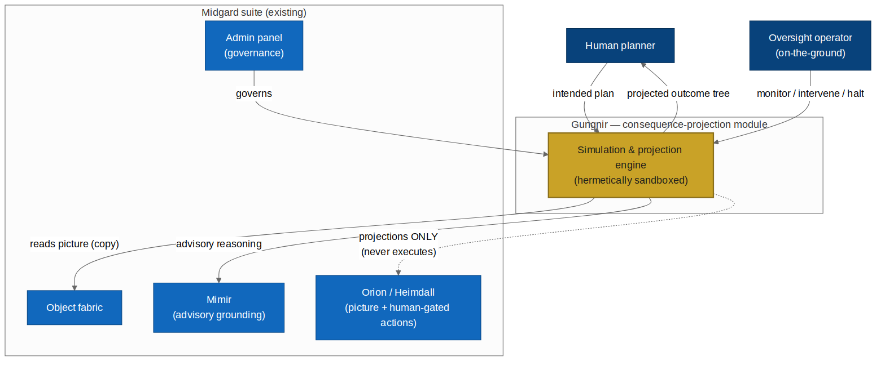
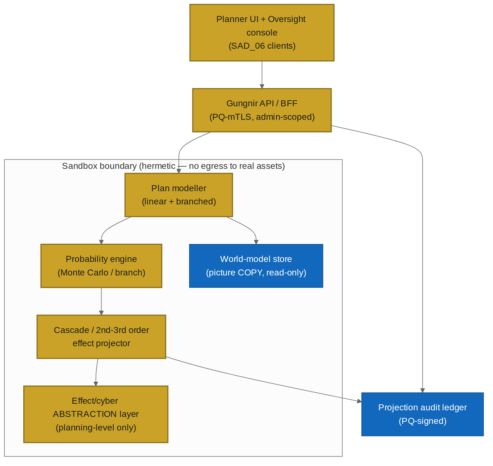
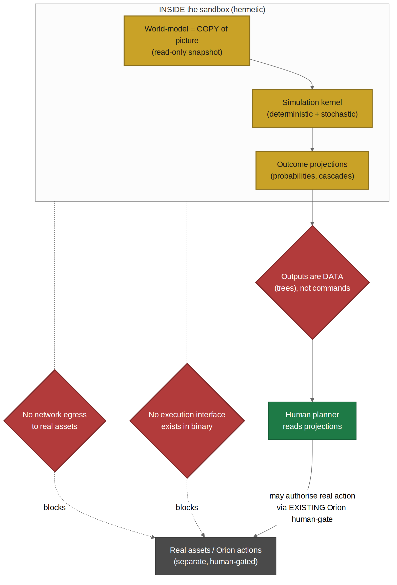
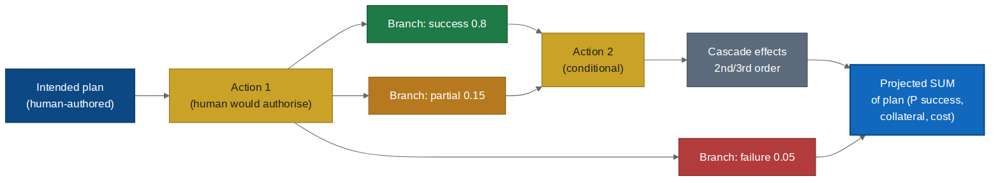
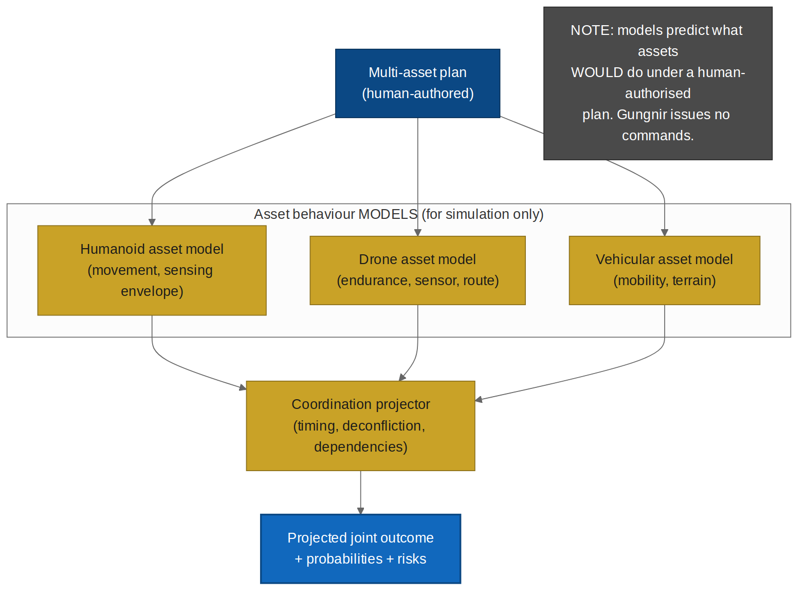
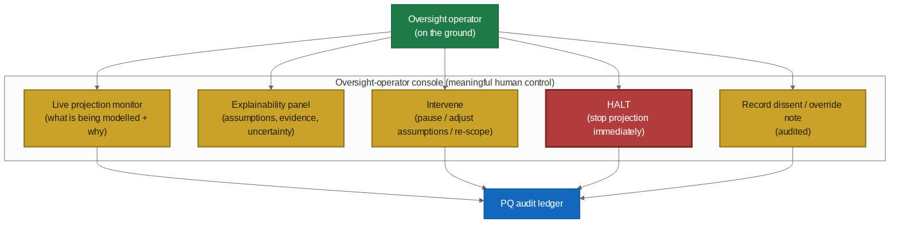
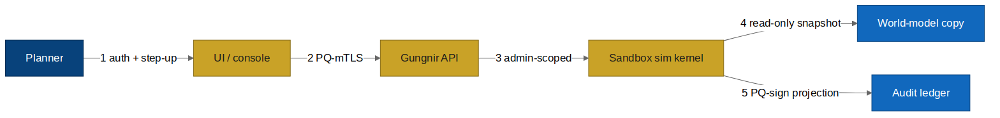

# Midgard Suite — Gungnir (Solutions Architecture Document)

*The consequence-projection module — forward-simulation of human-authorised plans, with on-the-ground oversight control*

**Module:** Gungnir · **Methodology:** Imhotep (arc42 + TOGAF + C4; NIST 800-53 / OWASP ASVS / ISO 27001)
**New:** FR-G-1..14, NFR-G-1..8, AC-G-1..20, prompts A.G-1..3 · **v1.0.0** · CONFIDENTIAL — RECIPIENT EYES ONLY
**Document type:** Forward-looking design specification (greenfield). Provenance tags: [DD-*], [FR-*]/[NFR-*], [STD:*].

> **WHAT GUNGNIR IS.** A consequence-projection engine. Given a human's intended plan (linear or branched, all human-authorised), it sandboxes the tree, models branch outcomes, computes probability-of-success across the campaign, and surfaces 2nd/3rd-order effects — so the human understands the SUM of a plan before authorising step one. Named for Odin's spear, guided by foresight.

> **WHAT GUNGNIR IS NOT — BY DESIGN.** No execution, no weapon/fire control, no closed-loop engagement, no reach into connected assets. No execution interface and no network path to a real asset exist. No fire-control or weapon-employment models; effects and cyber represented only as planning-level abstractions, never executable/reconstructable logic. Architectural absences, not switches. Real actions remain the human's, via the existing Orion/Heimdall human-gate.

## 1. Scope

| Capability | Status |
|---|---|
| Forward-simulate linear & branched human-authored plans | IN SCOPE (FR-G-1/2) |
| Probability-of-success across the plan tree | IN SCOPE (FR-G-3) |
| Cascade / 2nd–3rd order effect projection | IN SCOPE (FR-G-4) |
| Multi-asset (humanoid/drone/vehicle) behaviour MODELS | IN SCOPE — models, not control (FR-G-5) |
| Coordination/timing/deconfliction projection | IN SCOPE (FR-G-6) |
| On-the-ground oversight-operator console | IN SCOPE (FR-G-10..13) |
| Effect execution / weapon / fire control | **EXCLUDED** — no execution interface, no fire-control models |
| Automated / closed-loop engagement | **EXCLUDED** — closes no loop |
| Offensive cyber execution / forward-push into assets | **EXCLUDED** — cyber as abstraction only |

**Two carve-outs that keep this a planning tool:** (1) models THAT an effect occurs and what follows, but contains no weapon-employment/fire-control models — reasons at planning level, not fire-control level; (2) cyber actions are defensive/effect-level abstractions, never executable/reconstructable attack logic.

## 2. Functional requirements

FR-G-1 accept human-authored plan · FR-G-2 branched plans · FR-G-3 probability-of-success (action/branch/whole) · FR-G-4 cascade 2nd/3rd-order + collateral · FR-G-5 humanoid/drone/vehicle behaviour models (simulate, never command) · FR-G-6 coordination/timing/deconfliction · FR-G-7 projected SUM before authorisation · FR-G-8 compare alternative plans · FR-G-9 assumptions+evidence+uncertainty on every projection · FR-G-10 oversight live monitor · FR-G-11 intervene (pause/adjust/rescope/reject) · FR-G-12 immediate HALT always available · FR-G-13 audited dissent/override · FR-G-14 PQ-signed projection audit.

## 3. Non-functional requirements

NFR-G-1 hermetic sandbox: no egress to real assets, no execution interface in binary (impossible by construction) · NFR-G-2 read-only world-model copy · NFR-G-3 effect/cyber at planning-level abstraction; no fire-control/weapon-employment/exploit logic · NFR-G-4 PQ crypto throughout · NFR-G-5 air-gap/on-device · NFR-G-6 reproducible projections · NFR-G-7 simulation indelibly distinguished, never promoted · NFR-G-8 admin-governed, dual-control.

## 4. Architecture

- **Context:** reads a read-only picture copy, reasons with Mimir, projects to the planner, governed by admin; dashed line to Orion (informs the human who may authorise via Orion's human-gate — Gungnir has no path to action).
- **Containers:** plan modeller, probability engine (Monte Carlo/branch), cascade projector, world-model copy, effect/cyber abstraction layer — all inside the hermetic sandbox; PQ-signed audit ledger outside.

### The sandbox (deep dive) — three gates
- **G1 No egress:** no network route to any real asset (enforced at infrastructure boundary).
- **G2 No execution interface:** no API/call/path by which a projection becomes a command — absent, not disabled.
- **G3 Outputs are data:** projections are outcome trees; there is no command type in the schema.

Read-only versioned world-model (can't mutate live picture/fabric). Reproducible (inputs+seed → same tree). Abstraction layer keeps effects/cyber at planning granularity — harmful specifics are *not represented at all*, not stored at reduced fidelity.

### Multi-asset (models, not control)
Humanoid/drone/vehicle behaviour models predict what an asset WOULD do under a human-authorised plan; Gungnir issues no commands. "A drone could hold this orbit 40 min" is planning knowledge, categorically different from an interface that flies the drone.

### Oversight console (deep dive) — meaningful human control
Live monitor · explainability panel (assumptions/evidence/uncertainty) · intervene (pause/adjust/rescope/reject) · unconditional HALT · audited dissent. Principles: legibility over automation; intervention always available; dissent first-class; the operator is not automatable. Designed against oversight-as-theatre.

## 5. Security

STRIDE DFD with PQ controls. **Security case:** worst-case compromise is a manipulated projection — bad advice to a human who still authorises every real action elsewhere. Blast radius bounded at "wrong forecast", not "an action occurred", because Gungnir has no means to act.

**Known gaps:** manipulated projection (→ explainability+uncertainty+dissent+reproducible audit+red-team); automation bias (→ mandatory uncertainty, alternative comparison, training); abstraction-layer scope creep (→ design-review gate refuses any fire-control/exploit fidelity).

## 6. Prompts (extend SAD_05 Part A)

- **A.G-1 Plan projector:** projects branch outcomes with assumptions/uncertainty; planning-level only; refuses execution (PROJECTION_ONLY); surfaces collateral.
- **A.G-2 Cascade analyst:** explains 2nd/3rd-order effects; planning-level; recommends nothing.
- **A.G-3 Oversight monitor:** makes a run legible for the operator; always states HALT/intervene available; supports dissent, never argues the operator out of it.

All emit contract-validated JSON with citations+uncertainty, in Mimir's advisory envelope. Cross-cutting Eval EV-G-INV: no phrasing across any prompt executes, commands an asset, or emits fire-control/exploit logic.

## 7. Acceptance criteria

AC-G-1..20 covering: linear+branched projection with cited assumptions; mandatory uncertainty; collateral surfaced; multi-asset modelled-not-commanded; coordination; projected SUM before authorisation; alternative comparison; **sandbox has no egress + no execution interface (AC-G-9); read-only world-model (AC-G-10); planning-level abstractions only, no fire-control/exploit (AC-G-11); reproducible (AC-G-12); indelibly simulated (AC-G-13);** PQ audit; oversight monitor/intervene/**unconditional HALT (AC-G-17)**/audited dissent; **adversarial no-execution proof (AC-G-19);** air-gapped operation.

## 8. Integration & delivery

Orion (read-only copy; no execution path added) · Mimir advisory + SAD_02b model supply · SAD_06 client shells · SAD_07 dual-control governance incl. abstraction-layer changes · A.G-1..3 + AC-G-1..20 join SAD_05 (**consolidated ACs 124 → 144**).

**Delivery sequence:** sandbox + world-model copy (safety foundation) → projection engine → multi-asset models → oversight console → abstraction-layer review gate + full Eval/acceptance suite. Each capability lands with its safety control.

**Closing:** Gungnir is the sharpest decision-support in the suite — it lets a human see the whole consequence of a plan before committing to any part. Powerful because bounded: it forecasts reality without touching it. The spear that never misses is guided by foresight, not autonomy.
