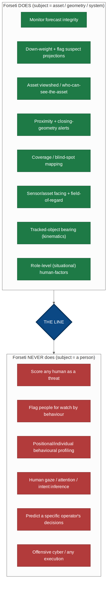
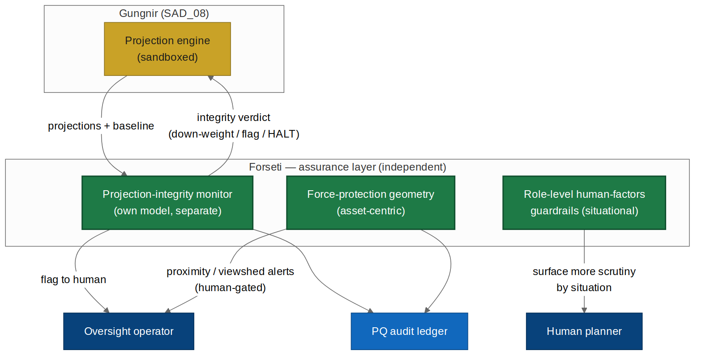
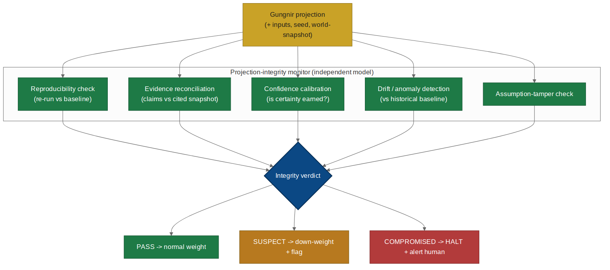
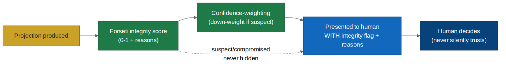
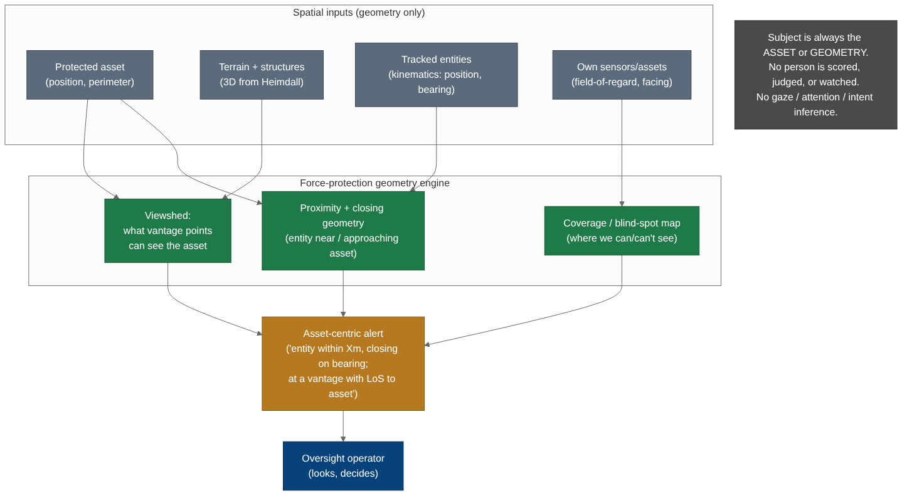
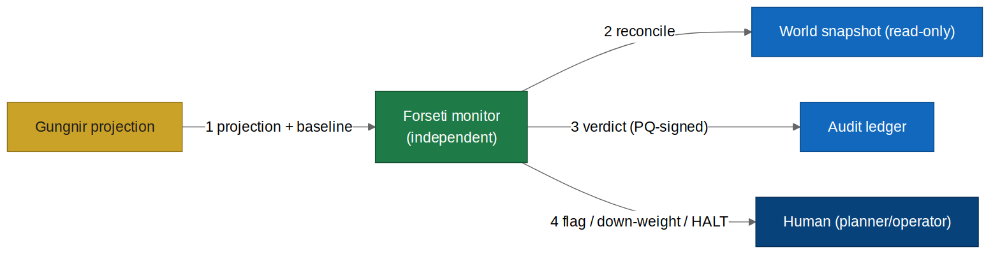

# Midgard Suite — Forseti (Gungnir Assurance Addendum)

*Forecast-integrity monitoring · integrity-confidence feedback · asset-centric force-protection geometry*

**Module:** Forseti — addendum to SAD_08 (Gungnir) · **Methodology:** Imhotep (arc42 + TOGAF + C4)
**New:** FR-F-1..14, NFR-F-1..6, AC-F-1..18, prompts A.F-1..3 · **v1.0.0** · PUBLIC, published with the Midgard repository

> **WHY FORSETI EXISTS.** Gungnir walls off execution, so its highest-value attack surface becomes the forecast itself and the human who consumes it. Forseti hardens that surface: an independent AI monitoring Gungnir's projections for manipulation/drift/unearned confidence; a feedback path so suspect forecasts are visibly flagged, never silently trusted; and asset-centric force-protection geometry so an operator is warned when something is near, or has line-of-sight to, a protected asset.

> **THE LINE.** Forseti's subject is always an ASSET, the GEOMETRY of the environment, or the SYSTEM's own forecast. It NEVER scores, judges, watches, or profiles a person. No flagging humans for watch, no positional/individual behavioural threat-scoring, no inference of any person's gaze/attention/intent. Force protection is spatial fact ('an entity is within X m of the asset, closing on this bearing; these vantage points have line-of-sight to it') handed to a human who looks and decides. Situational awareness, not automated suspicion.

**On the name.** Forseti is the Norse god of justice, truth, and reconciliation — the one who presides and delivers fair judgment. It fits the module's core function precisely: rendering a verdict on whether a forecast is honest (PASS / SUSPECT / COMPROMISED). Where Heimdall is the watchman who sees, Forseti is the judge who decides whether what is presented is sound. Aligns with the platform's Norse convention (Midgard, Mimir, Bifrost, Heimdall, Gungnir).

## 1. The three capabilities

1. **Projection-integrity monitoring** — independent oversight-AI (own model, separate trust boundary) checks every projection vs the reproducible baseline and cited snapshot; flags, down-weights, or HALTs, but never acts. (FR-F-1..6)
2. **Integrity-confidence feedback** — the verdict flows back so a suspect forecast is presented flagged with reasons, never silently trusted. (FR-F-7/8)
3. **Asset-centric force-protection geometry** — proximity + closing-geometry alerts plus asset/environment viewshed; all spatial, all human-gated. (FR-F-9..12)

**Independence (DD-F1):** a monitor sharing Gungnir's model/trust boundary would fall to the same attack it guards against. Forseti's monitor is separate model, separate boundary, own audit. Compromising Gungnir doesn't compromise its watchdog.

## 2. The line, explicitly

| Forseti DOES (subject = asset/geometry/system) | Forseti NEVER does (subject = a person) |
|---|---|
| Monitor forecast integrity; down-weight/flag suspect | Score any human as a threat/risk |
| Asset viewshed: which vantage points can see the asset | Flag people for watch by behaviour |
| Proximity + closing-geometry alerts | Positional/individual behavioural profiling |
| Coverage / blind-spot mapping | Infer any person's gaze/attention/intent |
| Sensor/asset facing + field-of-regard (own platforms) | Predict a specific operator's decisions |
| Tracked-object bearing (kinematics) | Any execution / weapon control / offensive cyber |
| Role-level (situational) human-factors guardrails | Individual human behavioural modelling |

**Rule in one line:** Forseti tells a human "something is near your asset — look". It never tells a human "that person is probably a problem — watch them". First is situational awareness; second is out of scope by design.

## 3. Functional requirements

FR-F-1 independent monitor (own model/boundary) · FR-F-2 reproducibility check · FR-F-3 evidence reconciliation · FR-F-4 confidence calibration · FR-F-5 drift/anomaly · FR-F-6 assumption-tamper · FR-F-7 verdict PASS/SUSPECT/COMPROMISED (down-weight/halt+alert) · FR-F-8 integrity-confidence feedback (never silently trusted) · FR-F-9 asset viewshed · FR-F-10 proximity + closing geometry (kinematics) · FR-F-11 coverage/blind-spots + field-of-regard · FR-F-12 asset-centric facts to human, no disposition against any person · FR-F-13 role-level (situational, non-individual) human-factors · FR-F-14 PQ-signed audit; never acts.

## 4. Non-functional requirements

NFR-F-1 monitor independence (separate model/boundary/audit; Gungnir compromise ≠ Forseti compromise) · NFR-F-2 no execution interface, no asset path; flags/halts, never acts · NFR-F-3 force-protection on asset/geometry/own-platform/kinematics ONLY; no facility to represent/infer a person's behaviour/gaze/attention/intent · NFR-F-4 human-factors situational/role-level only; no facility to model/identify/predict an individual · NFR-F-5 PQ + air-gap/on-device · NFR-F-6 admin-governed dual-control.

## 5. Integrity monitor

Five checks (reproducibility, evidence reconciliation, confidence calibration, drift, assumption-tamper) → verdict PASS / SUSPECT (down-weight+flag) / COMPROMISED (HALT+alert). Authority bounded like Gungnir's: flag/down-weight/HALT + alert a human; cannot act, cannot approve, cannot hide a COMPROMISED verdict.

## 6. Integrity-confidence feedback

Integrity score feeds confidence-weighting; SUSPECT projections down-weighted and shown with visible flag + reasons; COMPROMISED halts; the human always sees the integrity assessment. **This is the 'feed the probabilities back' idea kept safe: what feeds back is the INTEGRITY of the forecast, not a model of any human.**

## 7. Force-protection geometry

| Capability | Computes | Subject |
|---|---|---|
| Asset viewshed | Vantage points with LoS to the asset | Asset + terrain |
| Proximity + closing geometry | Entity within distance / approaching on bearing | Asset + object kinematics |
| Coverage / blind-spots | Where own sensors can/can't see | Own sensors + terrain |
| Field-of-regard | Own sensor/asset facing + coverage | Own platforms |

Example alert: "an unclassified entity is within 80 m of Asset-3 and closing on bearing 210°; it is at a vantage point with line-of-sight to the asset." Operator looks and decides. No threat score, no watch-flag, no judgement of the person.

## 8. Security

**Assurance case:** to deceive a human, an attacker must defeat Gungnir AND an independent monitor that re-derives the projection, reconciles it against evidence, checks confidence — and can never hide a COMPROMISED verdict. Forseti's own worst case: withhold a warning or raise a false one, never act.

**Known gaps:** correlated compromise (→ diverse model lineage + red-team); false safety from a pass (→ verdict is one input; human dissent retained); geometry→behaviour scope creep (→ design-review gate refuses any feature making a person the subject).

## 9. Prompts (extend SAD_05 Part A)

- **A.F-1 Integrity monitor:** independent assessment; verdict + reasons; never suppresses COMPROMISED; assesses forecast/system, never a person; refuses action (MONITOR_ONLY).
- **A.F-2 Force-protection geometry:** asset-centric spatial facts only; never describes/infers/scores a person's behaviour/gaze/intent; refuses profiling (GEOMETRY_ONLY).
- **A.F-3 Role-level human-factors:** situational/role over-trust mitigation; never models an individual; refuses prediction of a specific person (SITUATION_ONLY).

Cross-cutting Eval EV-F-INV: no phrasing across any prompt acts, scores/profiles a person, or infers gaze/intent.

## 10. Acceptance criteria

AC-F-1..18 covering: independent monitor; five integrity checks; SUSPECT/COMPROMISED with reasons; COMPROMISED never suppressed; suspect down-weighted+flagged; integrity accompanies every projection; asset viewshed; proximity/closing alerts from kinematics; coverage/blind-spots; **force-protection raises no disposition/score/watch-flag against any person (AC-F-10); no facility to infer behaviour/gaze/attention/intent (AC-F-11); no facility to model/predict an individual (AC-F-13);** no execution interface (AC-F-14); adversarial no-profile/no-act proof (AC-F-16); Gungnir compromise ≠ Forseti compromise (AC-F-17); air-gapped operation.

## 11. Integration & delivery

Monitors Gungnir (SAD_08); force-protection reuses Heimdall viewshed/3D and tracking; independent monitor model via SAD_02b diverse-lineage supply; SAD_07 dual-control governance incl. the geometry/behaviour boundary; A.F-1..3 + AC-F-1..18 join SAD_05 (**consolidated ACs 112 → 130**).

**Delivery sequence:** independent integrity monitor → integrity-confidence feedback → asset-centric force-protection geometry → role-level human-factors, with the geometry/behaviour design-review gate in place before any force-protection work begins.

**Closing:** Forseti hardens the one surface Gungnir cannot wall off by construction — the forecast and the human who reads it — and adds real force protection without ever making a person its subject. It watches things, and warns humans. It never watches people.
